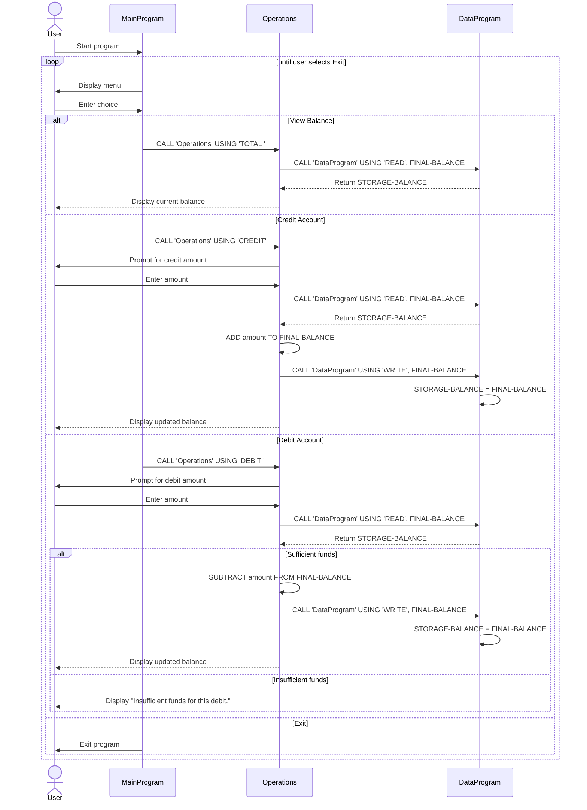

# Student Account COBOL Program Documentation

This legacy COBOL project models a simple account management system for a student account. It provides a menu-driven interface for viewing a current balance, crediting money to the account, debiting money from the account, and exiting the program.

## Overview

The application is split into three COBOL programs:

- `main.cob` handles the user menu and program flow
- `operations.cob` performs the account operations
- `data.cob` stores and retrieves the current balance

Together, they simulate a minimal account ledger with a persistent in-memory balance.

---

## File-by-file breakdown

### 1. `src/cobol/main.cob`

Purpose:
- Entry point for the application.
- Displays the account menu and routes the user to the appropriate action.

Key logic:
- Defines `USER-CHOICE` as a numeric menu selection.
- Uses a loop controlled by `CONTINUE-FLAG` until the user chooses to exit.
- Displays these options:
  - View Balance
  - Credit Account
  - Debit Account
  - Exit
- Calls the `Operations` program with operation codes:
  - `TOTAL `
  - `CREDIT`
  - `DEBIT `

Program behavior:
- Accepts input from the console.
- Evaluates the selected menu action with `EVALUATE`.
- Exits gracefully when option `4` is selected.

### 2. `src/cobol/operations.cob`

Purpose:
- Implements the financial operations for the student account.

Key logic:
- Receives an operation code through a linkage parameter named `PASSED-OPERATION`.
- Tracks `AMOUNT` and `FINAL-BALANCE`.
- Calls the data layer to read or write the account balance.

Operations performed:
- `TOTAL `: Reads the current balance and displays it.
- `CREDIT`: Prompts for an amount, reads the current balance, adds the credit, writes the updated balance, and displays the new total.
- `DEBIT `: Prompts for an amount, reads the current balance, checks funds, subtracts the amount if allowed, writes the updated balance, and displays the result.

Important validation:
- A debit is rejected when the account balance is less than the requested debit amount.
- This prevents overdraft and enforces a basic account safety rule.

### 3. `src/cobol/data.cob`

Purpose:
- Holds the stored account balance and exposes simple read/write operations.

Key logic:
- `STORAGE-BALANCE` starts at `1000.00`.
- Accepts an operation type and a balance value through linkage.
- Handles two actions:
  - `READ`: copies the stored balance into the caller's balance variable
  - `WRITE`: copies the updated value back into `STORAGE-BALANCE`

This file acts like a simple persistence layer for the program, even though it is implemented in working storage rather than a database or file.

---

## Business rules for student accounts

The COBOL logic reflects these operational rules:

1. Initial account balance
   - Every new session starts with a balance of `1000.00`.

2. Balance inquiry
   - A student may view the current balance at any time.

3. Credits
   - A credit increases the account total.
   - The updated balance is saved immediately after the transaction.

4. Debits
   - A debit decreases the account total.
   - A debit cannot be processed if it would make the balance negative.
   - If funds are insufficient, the program displays: `Insufficient funds for this debit.`

5. No overdraft allowance
   - The program enforces a no-negative-balance rule.
   - This is the primary business rule protecting the student account from overspending.

6. Menu-driven workflow
   - The user can only interact through the program menu.
   - The loop continues until the user chooses to exit.

---

## Example transaction flow

A typical session may look like this:

- Start with balance `1000.00`
- Choose `2` to credit the account
- Enter an amount such as `250.00`
- New balance becomes `1250.00`
- Choose `3` to debit the account
- Enter `100.00`
- New balance becomes `1150.00`
- Choose `4` to exit

---

## Notes

This program is intentionally simple and demonstrates legacy COBOL concepts such as:

- procedural branching
- linkage between modules
- working-storage state retention
- menu-driven command flow

It is a good example of a basic financial application in a mainframe-era programming style.

## Sequence Diagram

